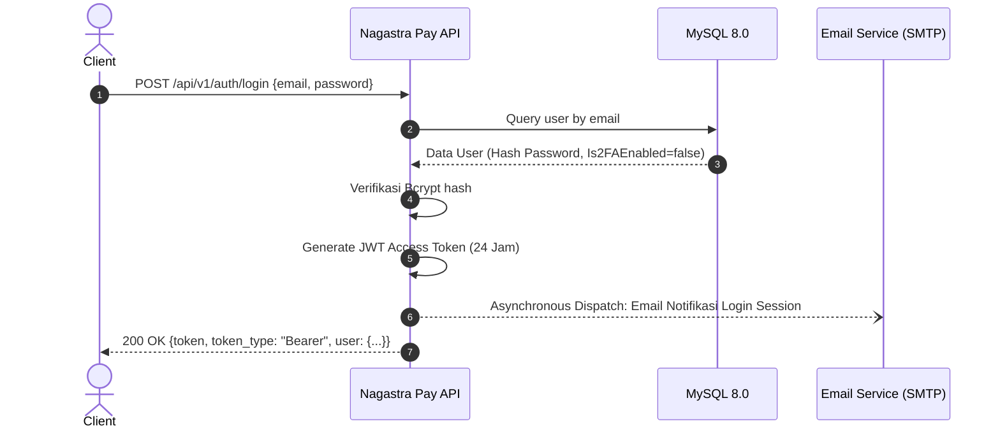
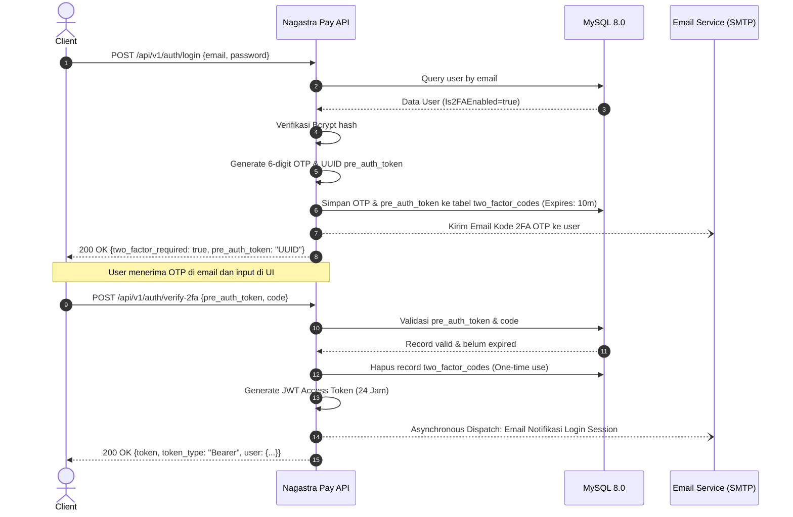
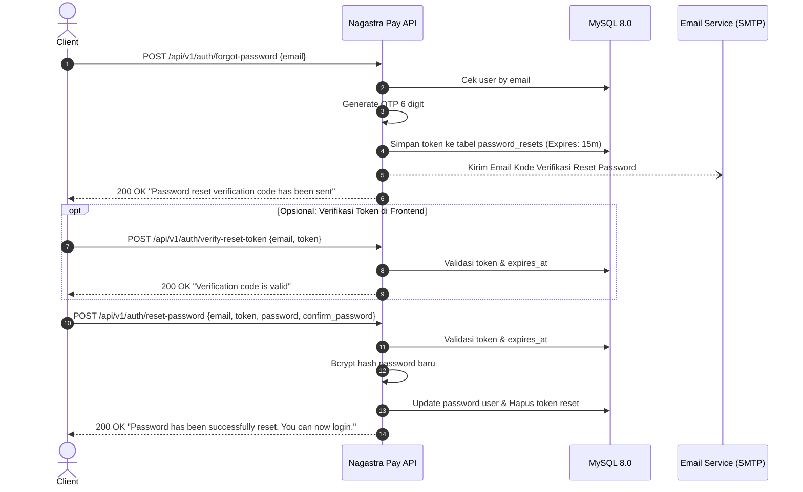

# Dokumentasi Lengkap API Authentication - Nagastra Pay

Dokumen ini menyediakan panduan integrasi dan spesifikasi teknis lengkap untuk grup endpoint **Authentication** pada backend Nagastra Pay.

---

## 1. Arsitektur & Konsep Keamanan

Sistem autentikasi Nagastra Pay dibangun di atas arsitektur Clean Architecture dengan standar keamanan industri:

- **JWT (JSON Web Token):**
  - Menggunakan algoritma **HS256**.
  - Payload claims: `user_id` (uint), `email` (string), `role` (string), `exp` (timestamp masa berlaku), `iat`, `nbf`.
  - Masa berlaku default: **24 jam** (`JWT_EXPIRE_HOURS=24`).
  - Digunakan sebagai Bearer Token pada header HTTP: `Authorization: Bearer <token>`.
- **Enkripsi Password:**
  - Menggunakan **Bcrypt** dengan default cost 10 (`bcrypt.DefaultCost`).
  - Password tersimpan dalam bentuk hash dan tidak pernah diekspos melalui API (`json:"-"`).
- **Two-Factor Authentication (2FA) via Email:**
  - Status bawaan akun baru: `is_2fa_enabled = false`.
  - Jika aktif, proses login memerlukan langkah verifikasi kode OTP 6 digit yang dikirimkan ke email user bersama token otentikasi sementara (`pre_auth_token`, berlaku 10 menit).
- **Session Security Alert (Pemberitahuan Login Baru):**
  - Setiap login yang berhasil akan memicu pengiriman email notifikasi keamanan secara asynchronous yang memuat:
    - Alamat IP Client (`c.ClientIP()`)
    - Informasi Perangkat/Browser (`User-Agent`)
    - Waktu login (WIB/Local Timezone)
- **Format Respon Standar:**
  Seluruh endpoint mengembalikan JSON dengan envelope standar:
  ```json
  {
    "success": true,
    "message": "Deskripsi hasil operasi",
    "data": { ... },
    "error": null,
    "meta": null
  }
  ```

---

## 2. Diagram Alur Autentikasi

### 2.1. Alur Login Tanpa 2FA (Default)



### 2.2. Alur Login Dengan 2FA Aktif



### 2.3. Alur Lupa & Reset Password



---

## 3. Ringkasan Endpoint

| No | Method | Endpoint Path | Autentikasi | Deskripsi Singkat |
|:---|:---|:---|:---|:---|
| 1 | `POST` | `/api/v1/auth/register` | Public | Pendaftaran pengguna baru |
| 2 | `POST` | `/api/v1/auth/login` | Public | Autentikasi kredensial (mendukung 2FA) |
| 3 | `POST` | `/api/v1/auth/verify-2fa` | Public | Verifikasi OTP 2FA untuk menyelesaikan login |
| 4 | `POST` | `/api/v1/auth/forgot-password` | Public | Permintaan kode reset password via email |
| 5 | `POST` | `/api/v1/auth/verify-reset-token` | Public | Verifikasi validitas kode OTP reset password |
| 6 | `POST` | `/api/v1/auth/reset-password` | Public | Eksekusi pergantian password dengan OTP |
| 7 | `POST` | `/api/v1/auth/refresh-token` | Public | Pembaruan masa aktif token JWT |
| 8* | `PATCH` | `/api/v1/profile/2fa` | Bearer Token | Mengaktifkan / menonaktifkan fitur 2FA |
| 9* | `PATCH` | `/api/v1/profile/change-password`| Bearer Token | Mengubah password akun terautentikasi |

*\*Endpoint nomor 8 & 9 berada di grup `/profile`, namun terintegrasi langsung dengan siklus kredensial autentikasi.*

---

## 4. Rincian Endpoint & Contoh Penggunaan

### 4.1. Register Pengguna Baru

Mendaftarkan akun pengguna baru ke sistem. Password akan di-hash menggunakan Bcrypt.

- **HTTP Method:** `POST`
- **URL Path:** `/api/v1/auth/register`
- **Headers:** `Content-Type: application/json`

#### Request Body
| Field | Tipe | Wajib | Validasi / Aturan | Keterangan |
| :--- | :--- | :--- | :--- | :--- |
| `name` | string | Ya | `min=2, max=100` | Nama lengkap pengguna |
| `email` | string | Ya | `email`, Unique | Alamat email valid & belum terdaftar |
| `phone` | string | Tidak | `min=8, max=20`, Unique | Nomor telepon / WhatsApp |
| `password` | string | Ya | `min=6` | Password akun |

#### Contoh Request Body
```json
{
  "name": "Fajri Ramadhan",
  "email": "fajri@example.com",
  "phone": "+6281234567890",
  "password": "SecurePassword123"
}
```

#### Contoh Response Sukses (`201 Created`)
```json
{
  "success": true,
  "message": "User registered successfully",
  "data": {
    "id": 1,
    "name": "Fajri Ramadhan",
    "email": "fajri@example.com",
    "phone": "+6281234567890",
    "role": "user",
    "is_active": true,
    "is_2fa_enabled": false,
    "created_at": "2026-10-16T10:00:00Z",
    "updated_at": "2026-10-16T10:00:00Z"
  },
  "error": null,
  "meta": null
}
```

#### Contoh Request cURL
```bash
curl -X POST "http://localhost:8080/api/v1/auth/register" \
  -H "Content-Type: application/json" \
  -d '{
    "name": "Fajri Ramadhan",
    "email": "fajri@example.com",
    "phone": "+6281234567890",
    "password": "SecurePassword123"
  }'
```

---

### 4.2. Login

Mengautentikasi pengguna. Jika user mengaktifkan 2FA, API akan mengembalikan `pre_auth_token` dan mengirim OTP ke email. Jika tidak aktif, API langsung menerbitkan JWT Bearer Token dan mengirim email alert sesi login baru.

- **HTTP Method:** `POST`
- **URL Path:** `/api/v1/auth/login`
- **Headers:** `Content-Type: application/json`

#### Request Body
| Field | Tipe | Wajib | Keterangan |
| :--- | :--- | :--- | :--- |
| `email` | string | Ya | Email terdaftar |
| `password` | string | Ya | Password akun |

#### Contoh Request Body
```json
{
  "email": "fajri@example.com",
  "password": "SecurePassword123"
}
```

#### Skenario A: 2FA Tidak Aktif (`two_factor_required = false`)
Login selesai langsung. JWT Token diterbitkan:

**Response Sukses (`200 OK`):**
```json
{
  "success": true,
  "message": "Login successful",
  "data": {
    "token": "eyJhbGciOiJIUzI1NiIsInR5cCI6IkpXVCJ9.eyJ1c2VyX2lkIjoxLCJlbWFpbCI6ImZhanJpQGV4YW1wbGUuY29tIiwicm9sZSI6InVzZXIiLCJleHAiOjE3NjA3NjgwMDB9...",
    "token_type": "Bearer",
    "expires_in": 86400,
    "two_factor_required": false,
    "user": {
      "id": 1,
      "name": "Fajri Ramadhan",
      "email": "fajri@example.com",
      "phone": "+6281234567890",
      "role": "user",
      "is_active": true,
      "is_2fa_enabled": false,
      "created_at": "2026-10-16T10:00:00Z",
      "updated_at": "2026-10-16T10:00:00Z"
    }
  },
  "error": null,
  "meta": null
}
```

#### Skenario B: 2FA Aktif (`two_factor_required = true`)
Token JWT belum diberikan. Server mengirimkan OTP 6 digit ke email dan mengembalikan `pre_auth_token`:

**Response Sukses (`200 OK`):**
```json
{
  "success": true,
  "message": "Login successful",
  "data": {
    "two_factor_required": true,
    "pre_auth_token": "a1b2c3d4-e5f6-7890-abcd-ef1234567890"
  },
  "error": null,
  "meta": null
}
```

#### Contoh Request cURL
```bash
curl -X POST "http://localhost:8080/api/v1/auth/login" \
  -H "Content-Type: application/json" \
  -d '{
    "email": "fajri@example.com",
    "password": "SecurePassword123"
  }'
```

---

### 4.3. Verifikasi 2FA OTP

Digunakan saat proses login menghasilkan `two_factor_required: true`. Masukkan kode OTP 6 digit dari email bersama `pre_auth_token`.

- **HTTP Method:** `POST`
- **URL Path:** `/api/v1/auth/verify-2fa`
- **Headers:** `Content-Type: application/json`

#### Request Body
| Field | Tipe | Wajib | Keterangan |
| :--- | :--- | :--- | :--- |
| `pre_auth_token` | string | Ya | UUID token sementara dari respon endpoint login |
| `code` | string | Ya | 6 digit kode angka yang diterima di email |

#### Contoh Request Body
```json
{
  "pre_auth_token": "a1b2c3d4-e5f6-7890-abcd-ef1234567890",
  "code": "849201"
}
```

#### Response Sukses (`200 OK`)
```json
{
  "success": true,
  "message": "2FA verification successful",
  "data": {
    "token": "eyJhbGciOiJIUzI1NiIsInR5cCI6IkpXVCJ9...",
    "token_type": "Bearer",
    "expires_in": 86400,
    "two_factor_required": false,
    "user": {
      "id": 1,
      "name": "Fajri Ramadhan",
      "email": "fajri@example.com",
      "phone": "+6281234567890",
      "role": "user",
      "is_active": true,
      "is_2fa_enabled": true,
      "created_at": "2026-10-16T10:00:00Z",
      "updated_at": "2026-10-16T10:00:00Z"
    }
  },
  "error": null,
  "meta": null
}
```

#### Contoh Request cURL
```bash
curl -X POST "http://localhost:8080/api/v1/auth/verify-2fa" \
  -H "Content-Type: application/json" \
  -d '{
    "pre_auth_token": "a1b2c3d4-e5f6-7890-abcd-ef1234567890",
    "code": "849201"
  }'
```

---

### 4.4. Forgot Password (Lupa Password)

Mengirimkan kode verifikasi 6 digit ke alamat email pengguna yang terdaftar untuk keperluan reset password. Kode berlaku selama 15 menit.

- **HTTP Method:** `POST`
- **URL Path:** `/api/v1/auth/forgot-password`
- **Headers:** `Content-Type: application/json`

#### Request Body
| Field | Tipe | Wajib | Keterangan |
| :--- | :--- | :--- | :--- |
| `email` | string | Ya | Email akun pengguna |

#### Contoh Request Body
```json
{
  "email": "fajri@example.com"
}
```

#### Response Sukses (`200 OK`)
```json
{
  "success": true,
  "message": "Password reset verification code has been sent to your email",
  "data": null,
  "error": null,
  "meta": null
}
```

#### Contoh Request cURL
```bash
curl -X POST "http://localhost:8080/api/v1/auth/forgot-password" \
  -H "Content-Type: application/json" \
  -d '{
    "email": "fajri@example.com"
  }'
```

---

### 4.5. Verify Reset Token

Memeriksa validitas kode OTP reset password sebelum pengguna mengisi form password baru di aplikasi frontend.

- **HTTP Method:** `POST`
- **URL Path:** `/api/v1/auth/verify-reset-token`
- **Headers:** `Content-Type: application/json`

#### Request Body
| Field | Tipe | Wajib | Keterangan |
| :--- | :--- | :--- | :--- |
| `email` | string | Ya | Email akun pengguna |
| `token` | string | Ya | Kode OTP 6 digit dari email |

#### Contoh Request Body
```json
{
  "email": "fajri@example.com",
  "token": "492018"
}
```

#### Response Sukses (`200 OK`)
```json
{
  "success": true,
  "message": "Verification code is valid",
  "data": null,
  "error": null,
  "meta": null
}
```

#### Contoh Request cURL
```bash
curl -X POST "http://localhost:8080/api/v1/auth/verify-reset-token" \
  -H "Content-Type: application/json" \
  -d '{
    "email": "fajri@example.com",
    "token": "492018"
  }'
```

---

### 4.6. Reset Password

Mereset password lama pengguna dengan password baru menggunakan kode verifikasi valid.

- **HTTP Method:** `POST`
- **URL Path:** `/api/v1/auth/reset-password`
- **Headers:** `Content-Type: application/json`

#### Request Body
| Field | Tipe | Wajib | Aturan | Keterangan |
| :--- | :--- | :--- | :--- | :--- |
| `email` | string | Ya | `email` | Email akun |
| `token` | string | Ya | - | Kode OTP 6 digit |
| `password` | string | Ya | `min=6` | Password baru |
| `confirm_password` | string | Ya | `eqfield=Password` | Konfirmasi password baru (harus sama persis) |

#### Contoh Request Body
```json
{
  "email": "fajri@example.com",
  "token": "492018",
  "password": "MyNewSecretPassword2026",
  "confirm_password": "MyNewSecretPassword2026"
}
```

#### Response Sukses (`200 OK`)
```json
{
  "success": true,
  "message": "Password has been successfully reset. You can now login.",
  "data": null,
  "error": null,
  "meta": null
}
```

#### Contoh Request cURL
```bash
curl -X POST "http://localhost:8080/api/v1/auth/reset-password" \
  -H "Content-Type: application/json" \
  -d '{
    "email": "fajri@example.com",
    "token": "492018",
    "password": "MyNewSecretPassword2026",
    "confirm_password": "MyNewSecretPassword2026"
  }'
```

---

### 4.7. Refresh Token

Menerbitkan JWT Access Token baru yang segar dari token lama yang masih valid.

- **HTTP Method:** `POST`
- **URL Path:** `/api/v1/auth/refresh-token`
- **Headers:** `Content-Type: application/json`

#### Request Body
| Field | Tipe | Wajib | Keterangan |
| :--- | :--- | :--- | :--- |
| `token` | string | Ya | JWT Access Token lama |

#### Contoh Request Body
```json
{
  "token": "eyJhbGciOiJIUzI1NiIsInR5cCI6IkpXVCJ9..."
}
```

#### Response Sukses (`200 OK`)
```json
{
  "success": true,
  "message": "Token refreshed successfully",
  "data": {
    "token": "eyJhbGciOiJIUzI1NiIsInR5cCI6IkpXVCJ9.eyJ1c2VyX2lkIjoxLCJlbWFpbCI6ImZhanJpQGV4YW1wbGUuY29tIiwicm9sZSI6InVzZXIiLCJleHAiOjE3NjA3NzIwMDB9...",
    "token_type": "Bearer",
    "expires_in": 86400,
    "two_factor_required": false,
    "user": {
      "id": 1,
      "name": "Fajri Ramadhan",
      "email": "fajri@example.com",
      "phone": "+6281234567890",
      "role": "user",
      "is_active": true,
      "is_2fa_enabled": false,
      "created_at": "2026-10-16T10:00:00Z",
      "updated_at": "2026-10-16T10:00:00Z"
    }
  },
  "error": null,
  "meta": null
}
```

#### Contoh Request cURL
```bash
curl -X POST "http://localhost:8080/api/v1/auth/refresh-token" \
  -H "Content-Type: application/json" \
  -d '{
    "token": "eyJhbGciOiJIUzI1NiIsInR5cCI6IkpXVCJ9..."
  }'
```

---

### 4.8. Toggle 2FA Setting (Profile Group)

Mengaktifkan atau menonaktifkan fitur Two-Factor Authentication via email pada akun pengguna saat ini.

- **HTTP Method:** `PATCH`
- **URL Path:** `/api/v1/profile/2fa`
- **Autentikasi:** Wajib menyertakan Header `Authorization: Bearer <JWT_ACCESS_TOKEN>`
- **Headers:** `Content-Type: application/json`

#### Request Body
| Field | Tipe | Wajib | Keterangan |
| :--- | :--- | :--- | :--- |
| `enable` | boolean | Ya | `true` untuk mengaktifkan 2FA, `false` untuk menonaktifkan |

#### Contoh Request Body
```json
{
  "enable": true
}
```

#### Response Sukses (`200 OK`)
```json
{
  "success": true,
  "message": "Two-factor authentication enabled successfully",
  "data": {
    "id": 1,
    "name": "Fajri Ramadhan",
    "email": "fajri@example.com",
    "phone": "+6281234567890",
    "role": "user",
    "is_active": true,
    "is_2fa_enabled": true,
    "created_at": "2026-10-16T10:00:00Z",
    "updated_at": "2026-10-16T10:30:00Z"
  },
  "error": null,
  "meta": null
}
```

#### Contoh Request cURL
```bash
curl -X PATCH "http://localhost:8080/api/v1/profile/2fa" \
  -H "Authorization: Bearer <JWT_ACCESS_TOKEN>" \
  -H "Content-Type: application/json" \
  -d '{
    "enable": true
  }'
```

---

### 4.9. Ganti Password / Change Password (Profile Group)

Mengganti password pengguna terautentikasi dengan memverifikasi password lama terlebih dahulu.

- **HTTP Method:** `PATCH`
- **URL Path:** `/api/v1/profile/change-password`
- **Autentikasi:** Wajib menyertakan Header `Authorization: Bearer <JWT_ACCESS_TOKEN>`
- **Headers:** `Content-Type: application/json`

#### Request Body
| Field | Tipe | Wajib | Aturan | Keterangan |
| :--- | :--- | :--- | :--- | :--- |
| `old_password` | string | Ya | - | Password saat ini |
| `new_password` | string | Ya | `min=6` | Password baru |
| `confirm_password` | string | Ya | `eqfield=NewPassword` | Konfirmasi password baru (harus identik) |

#### Contoh Request Body
```json
{
  "old_password": "SecurePassword123",
  "new_password": "MyNewSuperSecret2026!",
  "confirm_password": "MyNewSuperSecret2026!"
}
```

#### Response Sukses (`200 OK`)
```json
{
  "success": true,
  "message": "Password changed successfully",
  "data": null,
  "error": null,
  "meta": null
}
```

#### Contoh Request cURL
```bash
curl -X PATCH "http://localhost:8080/api/v1/profile/change-password" \
  -H "Authorization: Bearer <JWT_ACCESS_TOKEN>" \
  -H "Content-Type: application/json" \
  -d '{
    "old_password": "SecurePassword123",
    "new_password": "MyNewSuperSecret2026!",
    "confirm_password": "MyNewSuperSecret2026!"
  }'
```

---

## 5. Format & Penanganan Error Standar

Semua error pada API Nagastra Pay dipetakan ke format respon seragam:

### 5.1. Error Validasi Input (`422 Unprocessable Entity`)
Terjadi ketika field request body tidak memenuhi kriteria validasi (misal password kurang dari 6 karakter, format email salah, atau konfirmasi password tidak cocok):

```json
{
  "success": false,
  "message": "Validation failed",
  "data": null,
  "error": {
    "confirm_password": "confirm_password must be equal to password",
    "email": "email must be a valid email address",
    "password": "password must be at least 6 characters"
  },
  "meta": null
}
```

### 5.2. Error Kredensial Tidak Valid (`401 Unauthorized`)
Terjadi saat kombinasi email/password salah, atau token JWT kedaluwarsa/tidak valid:

```json
{
  "success": false,
  "message": "Invalid email or password",
  "data": null,
  "error": null,
  "meta": null
}
```

### 5.3. Error Semantic / Bad Request (`400 Bad Request`)
Terjadi jika email sudah terdaftar, nomor telepon duplikat, atau kode OTP salah/kedaluwarsa:

```json
{
  "success": false,
  "message": "Invalid or expired verification code",
  "data": null,
  "error": null,
  "meta": null
}
```

---

## 6. Contoh Integrasi Frontend (JavaScript / Axios)

Berikut adalah contoh implementasi alur login lengkap (termasuk deteksi 2FA) pada aplikasi frontend klien:

```javascript
import axios from "axios";

const API_BASE_URL = "http://localhost:8080/api/v1";

const apiClient = axios.create({
  baseURL: API_BASE_URL,
  headers: {
    "Content-Type": "application/json",
  },
});

// Interceptor untuk menyertakan Authorization Bearer Token
apiClient.interceptors.request.use((config) => {
  const token = localStorage.getItem("access_token");
  if (token) {
    config.headers.Authorization = `Bearer ${token}`;
  }
  return config;
});

// 1. Fungsi Login
export async function login(email, password) {
  try {
    const response = await apiClient.post("/auth/login", { email, password });
    const { data } = response.data;

    if (data.two_factor_required) {
      // 2FA diperlukan: Simpan pre_auth_token dan arahkan user ke input OTP
      sessionStorage.setItem("pre_auth_token", data.pre_auth_token);
      return { status: "2FA_REQUIRED", preAuthToken: data.pre_auth_token };
    }

    // Login langsung berhasil
    localStorage.setItem("access_token", data.token);
    return { status: "SUCCESS", user: data.user };
  } catch (error) {
    throw error.response?.data || error.message;
  }
}

// 2. Fungsi Verifikasi 2FA
export async function verify2FA(otpCode) {
  const preAuthToken = sessionStorage.getItem("pre_auth_token");
  if (!preAuthToken) {
    throw new Error("Sesi 2FA tidak ditemukan. Silakan login kembali.");
  }

  try {
    const response = await apiClient.post("/auth/verify-2fa", {
      pre_auth_token: preAuthToken,
      code: otpCode,
    });

    const { data } = response.data;
    localStorage.setItem("access_token", data.token);
    sessionStorage.removeItem("pre_auth_token");

    return { status: "SUCCESS", user: data.user };
  } catch (error) {
    throw error.response?.data || error.message;
  }
}
```
